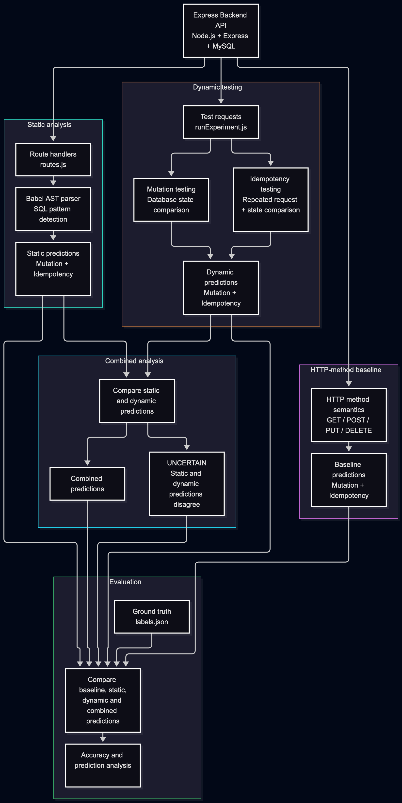

# API Behavior Analysis

A Node.js research prototype investigating persistent state mutation and operational idempotency in backend APIs through static source-code analysis and controlled dynamic testing.

## Research Objective

To examine how static analysis and dynamic testing can identify behavioral properties of backend API endpoints and compare their predictions with HTTP-method-based heuristics.

## Methodology

- **Static Analysis:** Uses JavaScript AST parsing with Babel Parser to identify SQL operations and infer API behavior.
- **Dynamic Testing:** Executes API requests and compares database snapshots to detect persistent state changes.
- **Idempotency Testing:** Repeats identical requests to observe whether subsequent executions cause additional database state changes.
- **Combined Analysis:** Compares static and dynamic predictions, marking disagreements or unavailable evidence as `UNCERTAIN`.
- **Evaluation:** Compares predictions against manually assigned ground-truth labels using accuracy and coverage.

## Pipeline Overview



*Figure 1: Evaluation pipeline. Each API endpoint is evaluated for persistent state mutation and operational idempotency using four approaches: an HTTP-method baseline, static analysis, dynamic testing, and combined analysis. Predictions are compared against manually assigned ground-truth labels. Disagreements or unavailable evidence in the combined analysis are reported as UNCERTAIN.*

## Technologies

JavaScript, Node.js, Express.js, MySQL, Babel Parser.

## Experimental Setup

The prototype evaluates ten API endpoints:

1. `GET /products`
2. `POST /products`
3. `PUT /products/:id`
4. `PUT /products/:id/increment`
5. `DELETE /products/:id`
6. `GET /products/:id/view`
7. `GET /products/:id/details`
8. `POST /products/upsert`
9. `POST /products/:id/audit`
10. `PATCH /products/:id/price`

The experiment evaluates two behavioral properties:

- **Persistent state mutation:** Whether an API request changes the persistent database state.
- **Operational idempotency:** Whether repeating an identical request causes additional persistent database state changes.

## Installation and Setup

**Prerequisites:** Node.js, npm, and MySQL.

### 1. Clone the repository

```bash
git clone https://github.com/Tushika-Sri/api-behavior-analysis.git
cd api-behavior-analysis
```

### 2. Install dependencies

```bash
npm install
```

### 3. Configure the database

Create the database and tables, and insert the sample records using the provided schema:

```bash
mysql -u root -p < database/schema.sql
```

Enter your MySQL password when prompted.

### 4. Configure environment variables

Create a `.env` file in the project root:

```env
DB_HOST=localhost
DB_USER=root
DB_PASSWORD=your_password
DB_NAME=api_behavior_analysis
PORT=3000
```

Replace the placeholder values with your local MySQL credentials. Do not commit your `.env` file.

### 5. Start the API server

```bash
node src/server.js
```

### 6. Run the experiment

Open another terminal:

```bash
node src/runExperiment.js
```

The endpoint predictions and evaluation summary are printed in the terminal.

## Results

The following tables present the evaluation results from the ten-endpoint experiment. Accuracy is calculated using definite predictions only, excluding `UNCERTAIN` results. Coverage represents the proportion of evaluated endpoints for which a definite prediction was produced.

### Mutation

| Approach | Accuracy | Coverage |
|---|---:|---:|
| HTTP baseline | 8/10 (80.0%) | 10/10 (100.0%) |
| Static analysis | 9/9 (100.0%) | 9/10 (90.0%) |
| Dynamic testing | 10/10 (100.0%) | 10/10 (100.0%) |
| Combined analysis | 9/9 (100.0%) | 9/10 (90.0%) |

### Idempotency

| Approach | Accuracy | Coverage |
|---|---:|---:|
| HTTP baseline | 6/10 (60.0%) | 10/10 (100.0%) |
| Static analysis | 7/8 (87.5%) | 8/10 (80.0%) |
| Dynamic testing | 10/10 (100.0%) | 10/10 (100.0%) |
| Combined analysis | 7/7 (100.0%) | 7/10 (70.0%) |

### Observations

- The HTTP-method baseline produced predictions for all ten endpoints but misclassified some behavioral properties.
- Static analysis achieved high accuracy among definite predictions but could not resolve every endpoint, particularly where behavior involved imported helper functions.
- Dynamic testing correctly classified all ten endpoints under the tested conditions.
- Combined analysis achieved 100% accuracy among its definite idempotency predictions, with 70% coverage. It reported uncertain results where static and dynamic evidence disagreed or where static analysis could not resolve the behavior.

## Limitations

- Evaluation is limited to ten API endpoints.
- Database-state observation covers only the products and product_audit tables.
- Ground-truth labels are manually assigned based on endpoint implementation.
- Static analysis uses simplified JavaScript AST and SQL pattern detection and does not comprehensively resolve behavior across imported helper functions.
- Idempotency is evaluated through observed database-state changes, not HTTP response equivalence.
- Dynamic results are limited to the tested requests, inputs, and database conditions.

The results are preliminary and limited to the current proof of concept. They should not be interpreted as evidence of general accuracy across arbitrary APIs.
